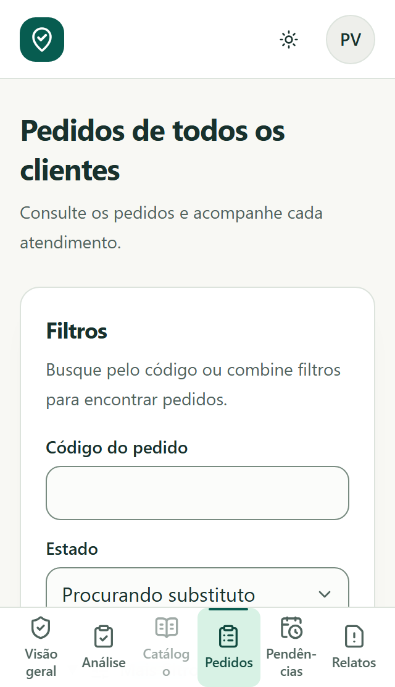

# Refinamento de usabilidade

O Chrome abriu a aplicação local em um ambiente de teste isolado. As consultas usaram dados de teste apenas em memória. A captura mostra o painel de pedidos em viewport móvel de 320 px em tema claro.

## Verificação no Chrome

| Tela | 320 px | 375 px | 768 px | 1024 px | 1440 px |
| --- | --- | --- | --- | --- | --- |
| Início do cliente e Swiper | OK | OK | OK | OK | OK |
| Meus pedidos | OK | OK | OK | OK | OK |
| Detalhe do pedido do cliente | OK | OK | OK | OK | OK |
| Formulário de solicitação | OK | OK | OK | OK | OK |
| Pedidos administrativos | OK | OK | OK | OK | OK |
| Detalhe administrativo do pedido | OK | OK | OK | OK | OK |
| Agenda de disponibilidade | OK | OK | OK | OK | OK |

A matriz verificou a largura da página e dos controles principais nos temas claro e escuro. No desktop, o modo compacto ampliou a área do Swiper e da tabela. A inspeção manual conferiu o tooltip com foco, a abertura de “Mais filtros” pelo teclado e a etiqueta após consultar. Em zoom de 200%, a agenda escura manteve o cabeçalho e a navegação mobile acessíveis, incluindo a abertura do menu do avatar após rolar.

A ferramenta de controle do navegador interrompeu a sessão quando deixou de confirmar a URL da aba. A conferência manual dos modais no Chrome ficou pendente.
